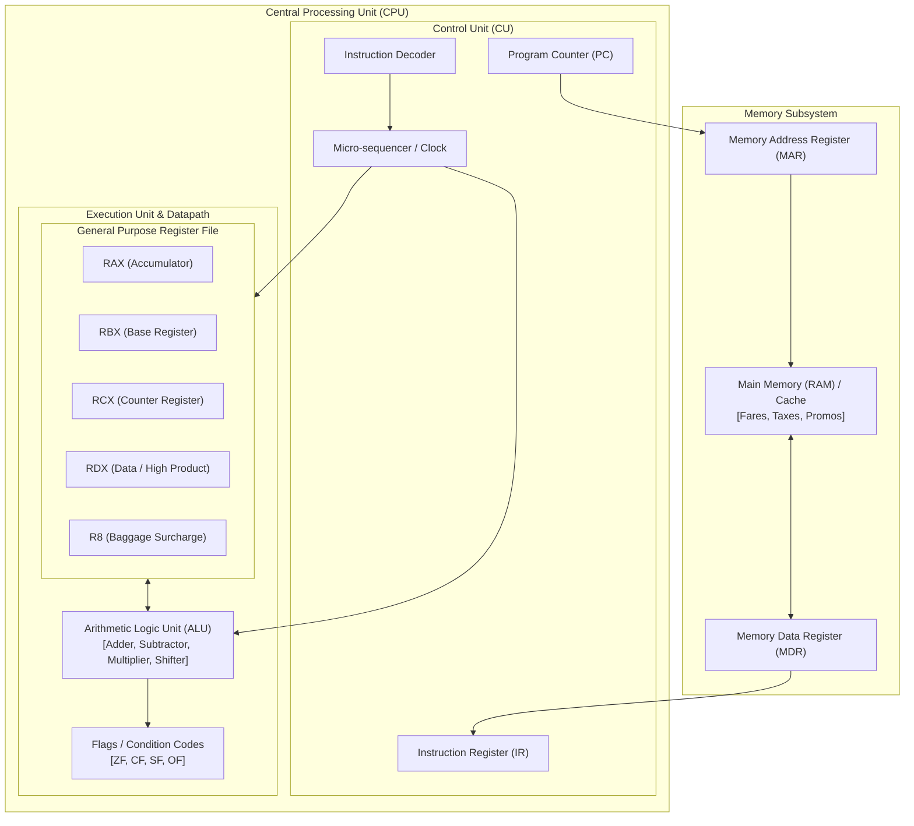

# Mapping Table: Airline Fare Operations to Processor Components
## Computer Organization & Architecture (COA) Technical Specification

---

## 1. Architectural Scope & Overview

In the **Airline Reservation & Boarding System**, fare calculation is computed both at the high-level application layer and at the low-level micro-architectural layer using **x86-64 NASM Assembly** (`coa-nasm/` & `assembly-component/fare_calc.asm`).

This document provides the formal **Mapping Table** establishing the direct correspondence between each discrete airline fare operation and the physical components of the Central Processing Unit (CPU) and memory subsystem.



---

## 2. Comprehensive Processor Component Mapping Table

| Stage | Airline Fare Operation | Assembly Instruction | Primary Processor Component | Secondary Component | Data / Control Bus Activity | Flags Affected |
| :---: | :--- | :--- | :--- | :--- | :--- | :---: |
| **01** | **Base Fare Retrieval**<br/>Loads base fare ($₹5,000$) from memory | `MOV RAX, [base_fare]` | **Memory Data Register (MDR) & Accumulator (RAX)** | Memory Address Register (MAR), Bus Interface | **Address Bus**: Transmits memory address of base fare.<br/>**Data Bus**: Transmits 64-bit value `0x1388`.<br/>**Control Bus**: Assert `MEM_READ` signal. | None (Data transfer) |
| **02** | **Aviation Tax Loading**<br/>Loads fixed aviation security tax ($₹900$) | `MOV RBX, 900` | **Base Register (RBX)** | Instruction Register (IR), Immediate Data Latch | **Internal CPU Bus**: Immediate value `0x0384` transferred from instruction buffer to RBX. | None |
| **03** | **Tax Accumulation (ALU Addition)**<br/>Computes intermediate fare ($₹5,000 + ₹900 = ₹5,900$) | `ADD RAX, RBX` | **Arithmetic Logic Unit (ALU) - Parallel Adder** | Accumulator (RAX), Operand Latch | **Datapath**: Values from RAX and RBX gated into ALU input latches; result `0x170C` written back to RAX via writeback bus. | **CF** = 0 (no carry)<br/>**ZF** = 0 (non-zero)<br/>**SF** = 0 (positive)<br/>**OF** = 0 |
| **04** | **Cabin Class Scaling**<br/>Applies class multiplier (Economy 1.0x, Business 1.8x, First Class 2.5x) | `MUL RDX` or `SHL RAX, 1` + `ADD RAX, RDX` | **ALU Multiplier / Barrel Shifter** | High-Order Register (RDX), Accumulator (RAX) | **Datapath**: Multiplier logic gates RAX with multiplier operand; 128-bit product split across RDX:RAX. | **CF**, **OF** set if product exceeds 64 bits |
| **05** | **Excess Baggage Surcharge Evaluation**<br/>Checks if baggage weight $> 15$ kg | `CMP R8, 15`<br/>`JBE no_surcharge` | **ALU Comparator & Program Counter (PC)** | Control Unit (CU) Branch Logic, Instruction Decoder | **Datapath**: ALU performs internal subtraction `R8 - 15` without storing result.<br/>**Control**: If condition met, PC updated with target branch address. | **ZF** = 1 if exactly 15 kg<br/>**CF** = 1 if $< 15$ kg (borrow)<br/>**SF** = 0 |
| **06** | **Excess Baggage Surcharge Addition**<br/>Adds surcharge ($₹500 \times \text{kg}_{\text{excess}}$) | `ADD RAX, R9` | **ALU 64-bit Full Adder** | Accumulator (RAX), Register R9 | **Internal Bus**: Transmits calculated surcharge into ALU adder latch; updates RAX. | **CF** = 0, **ZF** = 0, **SF** = 0 |
| **07** | **Promotional Discount Loading**<br/>Loads discount voucher ($₹500$) | `MOV RCX, 500` | **Counter Register (RCX)** | Instruction Decoder, Immediate Latch | **Datapath**: Immediate `0x01F4` placed in RCX. | None |
| **08** | **Discount Subtraction (ALU 2's Complement)**<br/>Final Fare = $₹5,900 - ₹500 = ₹5,400$ | `SUB RAX, RCX` | **ALU Subtractor (2's Complement Inverter + Adder)** | Accumulator (RAX), Flags Register | **Datapath**: RCX inverted (`NOT RCX + 1`) and summed with RAX. Result `0x1518` written back to RAX. | **CF** = 0 (no borrow)<br/>**ZF** = 0<br/>**SF** = 0 |
| **09** | **Zero/Negative Fare Verification**<br/>Ensures final payable fare $> 0$ | `TEST RAX, RAX`<br/>`JLE invalid_fare` | **ALU Bitwise Logic Unit & Control Unit** | Status Register, Branch Prediction Unit | **Datapath**: Bitwise `AND` on RAX to set ZF and SF without altering RAX contents. | **ZF** = 1 if free ($₹0$)<br/>**SF** = 1 if negative |
| **10** | **Currency BCD Conversion**<br/>Converts binary/hex fare to decimal BCD (`HexToBCD.asm`) | Shift, Mask & Binary Division Loop | **ALU Barrel Shifter, Divider & Temp Registers** | Accumulator (RAX), Shift Control Unit | **Datapath**: Modulo 10 divisions produce decimal digits packed into 4-bit nibbles. | **ZF**, **CF** per iteration |
| **11** | **Result Return & ABI Calling Convention**<br/>Returns calculated fare to host caller | `RET` | **Stack Pointer (RSP), Program Counter (PC)** | Bus Interface Unit, Call Stack | **Data Bus**: Pops return address from stack frame `[RSP]` into `PC`. Value in `RAX` serves as return value. | None |

---

## 3. Register Allocation Strategy & Roles

```text
+---------------+--------------------------------------------------------------+
| Register Name | Dedicated Architectural Role in Fare Engine                  |
+---------------+--------------------------------------------------------------+
| RAX           | Accumulator: Holds Base Fare, receives intermediate sums,    |
|               | and delivers final net payable fare.                         |
| RBX           | Base Register: Holds fixed aviation security taxes and fees. |
| RCX           | Counter Register: Holds promo discount codes / loop counter. |
| RDX           | Data Register: Holds high-order bits in multiplication / mod.|
| R8            | Operand Register: Passenger baggage weight (kg).             |
| R9            | Operand Register: Computed baggage excess surcharge (₹).     |
| RDI / RSI     | System V ABI Parameter Passing: Airport distance / pax count.|
| RSP / RBP     | Stack Management: Stack Pointer and Base Frame Pointer.      |
| EFLAGS        | Condition Codes: ZF (Zero), CF (Carry/Borrow), SF (Sign).    |
+---------------+--------------------------------------------------------------+
```

---

## 4. Control Unit Micro-Operation Lifecycle (Fetch-Decode-Execute)

For the fundamental instruction `ADD RAX, RBX` (Aviation Tax Accumulation):

1. **Clock Cycle $T_1$ (Fetch)**:
   $$\text{MAR} \leftarrow \text{PC}$$
   $$\text{Control Bus} \leftarrow \text{MEM\_READ}$$
   $$\text{PC} \leftarrow \text{PC} + 8$$
2. **Clock Cycle $T_2$ (Decode)**:
   $$\text{IR} \leftarrow \text{MDR}$$
   $$\text{Control Unit Decoder} \leftarrow \text{IR}[\text{opcode}]$$
3. **Clock Cycle $T_3$ (Execute)**:
   $$\text{ALU Input 1} \leftarrow \text{RAX}$$
   $$\text{ALU Input 2} \leftarrow \text{RBX}$$
   $$\text{ALU Operation} \leftarrow \text{ADD}$$
4. **Clock Cycle $T_4$ (Writeback & Flag Update)**:
   $$\text{RAX} \leftarrow \text{ALU Output}$$
   $$\text{EFLAGS} \leftarrow \text{ALU Status Signals (ZF, CF, SF, OF)}$$
