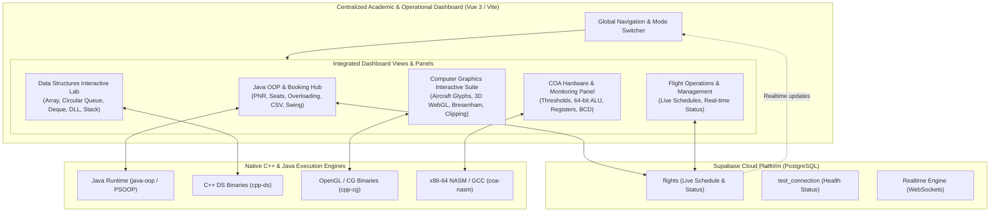

# MASTER ARCHITECTURAL ANALYSIS & SYSTEM INTEGRATION PLAN
## Airline Reservation, Seat Management & Boarding System
### Full Multi-Subject Integration with Supabase Cloud & Vue 3 Dashboard

---

## Executive Summary & System Scope

The **Airline Reservation, Seat Management & Boarding System** is an engineering project that demonstrates the confluence of five core computing disciplines:
1. **Java Object-Oriented Programming (PSOOP & JDBC)**: Robust domain modeling, polymorphism, custom exceptions, validation, PNR algorithms, file handling, and Swing/JDBC operations.
2. **Data Structures & Algorithms (C++ DS / PL)**: Linear and non-linear data structures including Passenger Arrays, Circular Queues, Priority Deques, Linked Lists, Doubly Linked Lists for manifest merges, 2D Seat Matrices, and Undo Stacks.
3. **Computer Organization & Architecture (COA & Assembly)**: Low-level arithmetic, 64-bit x86-64 NASM registers (`RAX`, `RBX`, `RCX`), BCD/Hexadecimal conversions, Control Unit fetch-decode-execute simulation, and hardware seat occupancy threshold detection.
4. **Computer Graphics (C++ CG / CGL)**: Rasterization algorithms (Bresenham, DDA), clipping (Cohen-Sutherland), polygon filling (Flood Fill, Scanline), 2D transformations (translation, scaling, zone zooming), lighting, texture mapping, and 3D wireframe/solid aircraft models (`Aircraft3D.cpp`).
5. **Full-Stack Web & Cloud Database (Vue 3, Node.js Express, Supabase PostgreSQL)**: Modern responsive dashboard, transactional persistence, live real-time synchronization, and centralized dashboard visualization.

This document establishes the **complete architectural inventory, dependency graph, and step-by-step integration roadmap** to unify every single module into a modern, centralized Airline Management Dashboard.

---

## 1. Deep Codebase Inventory & Subject Analysis

### 1.1 Module 1: Java OOP & Airline Reservation (`java-oop/`, `java-oop-coa-ui/`, `AirlineForm/`)
* **Core Classes & Architecture**:
  * `model.Person`: Abstract base class with encapsulation (`name`, `email`, `phone`, `address`, `dob`).
  * `model.Passenger`: Inherits `Person`; implements `IBoardable` interface (`boardFlight()`, `getBoardingPass()`, `preferredClass`, `passportNumber`).
  * `model.StaffMember`: Inherits `Person`; implements `ISafetyCertified` interface (`staffId`, `department`, `designation`, `conductSafetyCheck()`).
  * `model.Pilot`: Inherits `StaffMember`; represents cockpit flight crew.
  * `model.SeatClass`: Base class for cabin classes with Polymorphic methods `calculateFare(baseFare)` and `getPriority()`.
    * Subclasses: `model.Economy` (priority 3, multiplier 1.0x), `model.Business` (priority 2, multiplier 1.8x), `model.FirstClass` (priority 1, multiplier 2.5x).
  * `model.Flight`: Encapsulates flight schedule, route (`source`, `destination` as `Airport`), and **compile-time method overloading** for fare computation:
    1. `calculateFare()`
    2. `calculateFare(travelClass)`
    3. `calculateFare(travelClass, baggageKg)`
    4. `calculateFare(travelClass, baggageKg, promoCode)`
  * `model.PNR`: Static utility using `SecureRandom` to generate 6-character uppercase alphanumeric booking reference codes from `ABCDEFGHJKLMNPQRSTUVWXYZ23456789`.
  * `model.Booking`: Represents confirmed booking entity tying passenger, flight, seat, and PNR.
  * `model.BookingService`: Orchestrates reservation workflow, seat locks, and status transitions.
  * `structures.Seat`: Represents seat position (`row`, `col`), class, and occupancy state.
  * `util.BookingFileManager`: Robust file handling supporting versioned CSV records (`bookings.csv`), record deserialization, corruption detection, and automated backup.
  * `model.DBConnection`: JDBC MySQL connectivity manager with automatic connection pooling fallback.
  * `FlightStatusForm.java`: Java Swing desktop GUI form with JDBC connectivity to manage flight statuses (`On Time`, `Delayed`, `Cancelled`, `Boarding`, `Departed`).
  * `BookingSystemTest.java`: Complete test suite validating 13/13 unit tests for booking, cancellation, and boarding priority.

### 1.2 Module 2: Data Structures & Algorithms (`cpp-ds/`)
* **Implemented Data Structures & Source Files**:
  * `PassengerArray.cpp / .h`: Fixed-capacity array (`MAX_PASSENGERS = 50`) supporting:
    * `addPassenger()`, `updatePassenger()`, `deletePassenger()`
    * Linear search & search by PNR
    * Array bounds checking and passenger count tracking.
  * `BoardingQueueCircular.cpp`: Fixed-size circular queue using modulo arithmetic:
    * `rear = (rear + 1) % capacity`
    * `front = (front + 1) % capacity`
    * Explicit `count` variable preventing front/rear ambiguity on empty vs. full states.
    * Priority boarding group calling.
  * `Checkindeque`: Double-ended circular queue (`CAPACITY = 6`) supporting:
    * `insertFront()`, `insertRear()`, `deleteFront()`, `deleteRear()`
    * Priority categorization: Elderly ($\ge 60$) and VIP at front, Normal at rear.
    * Three operational modes: `UNRESTRICTED`, `INPUT_RESTRICTED`, `OUTPUT_RESTRICTED`.
  * `LinkedList.cpp`: Singly linked list (`BookingHistoryList`) for booking history:
    * Dynamic `BookingNode` insertion at tail
    * Sequential PNR traversal and search.
  * `ManifestMergeDLL.cpp`: Doubly linked list (`Node` with `prev` and `next` pointers):
    * Merges two sorted boarding-group manifests into a single sorted master manifest.
    * `seatComesBefore()`: Alphanumeric seat comparator sorting by row (numeric) then column letter (alphabetic).
  * `SeatMap2D.cpp / .h`: 2D array representation ($30 \times 6$ grid, 180 seats):
    * Sparse occupancy tracking via `std::vector<std::tuple<int,int,int>>`
    * Seat class mapping (Rows 0–1 First, 2–6 Business, 7–29 Economy).
    * Automatic blocking of Emergency Exit Row 10.
  * `undostack.cpp`: Array-based LIFO stack (`Action` struct storing seat and action type `'S'`/`'C'`):
    * `push()`, `pop()`, `peek()`
    * Enables instantaneous undo of accidental seat selections or cancellations.
  * `Waitlist.cpp / .h`: FIFO passenger waitlist queue:
    * Automated passenger promotion upon booking cancellation.

### 1.3 Module 3: Computer Organization & Architecture (`coa-nasm/`, `assembly-component/`, `java-oop-coa-ui/`)
* **Implemented Architecture Components**:
  * `fare_calc_sim.cpp` & `fare_calc.asm`: 64-bit hardware register simulation:
    * `RAX`: Accumulator for base fare and total result.
    * `RBX`: Base register storing aviation taxes and fuel surcharges.
    * `RCX`: Counter register storing promotional discount.
    * Instruction sequence: `MOV RAX, 5000` $\rightarrow$ `MOV RBX, 900` $\rightarrow$ `MOV RCX, 500` $\rightarrow$ `ADD RAX, RBX` $\rightarrow$ `SUB RAX, RCX`.
  * `HexToBCD.asm`: Converts 64-bit hexadecimal values into Binary Coded Decimal (Packed and Unpacked BCD) using binary shifts and division loops.
  * `MulAddShift.asm` & `multisuccadd.asm`: Multiplication via successive addition vs. shift-and-add algorithm simulating ALU micro-operations.
  * `PNRStringOps.asm`: Assembly string manipulation for PNR hashing and validation.
  * `controlunit.java`: Micro-architectural control unit simulation:
    * Fetch-Decode-Execute pipeline cycle.
    * ALU execution of `ADD`, `SUB`, `MUL` opcodes.
  * **Hardware Seat Occupancy Monitoring & Digital Logic**:
    * Threshold detection:
      * $\text{Occupancy} < 75\% \implies \mathbf{OPEN}$ (Status Green)
      * $75\% \le \text{Occupancy} < 90\% \implies \mathbf{RUNNING\ LOW}$ (Status Amber)
      * $\text{Occupancy} \ge 90\% \implies \mathbf{FULL}$ (Status Red)
    * Register bitmasks & Flag status simulation (Zero Flag ZF, Carry Flag CF, Sign Flag SF).

### 1.4 Module 4: Computer Graphics Visualization (`cpp-cg/`)
* **Implemented Visualizers & Algorithms**:
  * `PlaneGlyph.cpp`: Top-down aircraft glyph rendering fuselage, swept wings, wingtips, horizontal/vertical stabilizers, and jet engine pods.
  * `Seats.cpp`: Cabin seat matrix layout:
    * Cockpit: 2 pilot seats
    * First Class: 2 rows $\times$ 4 seats ($2+2$ layout)
    * Business Class: 4 rows $\times$ 4 seats ($2+2$ layout)
    * Economy Class: 9 rows $\times$ 6 seats ($3+3$ layout)
    * Attendant/Crew seats: 4 stations.
  * `SeatMapTransform.cpp`: Transformation engine:
    * Window-to-Viewport transformation
    * Translation ($T_x, T_y$) and Scaling ($S_x, S_y$)
    * Zone Zooming: Smooth sliding animation targeting Full Aircraft, First Class, Business Class, or Economy Class.
  * `Aircraft3D.cpp`: Complete 3D solid and wireframe aircraft model:
    * Primitives: Cylinder fuselage, sphere nose, cone tail, scaled cube wings and stabilizers.
    * Depth testing (`GL_DEPTH_TEST`), directional lighting, and specular highlights.
    * Interactive 3-axis rotation (Pitch, Yaw, Roll) and camera distance zoom.
  * `Bresenham.cpp`: Integer-based line rasterization using decision parameter $p_k = 2\Delta y - \Delta x$ to connect flight route waypoints without floating-point math.
  * `DDALine.cpp`: Digital Differential Analyzer floating-point line drawing for performance comparison.
  * `LineClipping.cpp`: Cohen-Sutherland line clipping algorithm with 4-bit region outcodes ($\text{Top}, \text{Bottom}, \text{Right}, \text{Left}$) clipping routes to a rectangular viewing window.
  * `Floodfill.cpp`: 4-connected flood-fill algorithm for cabin zone coloring.
  * `ScanlineFill.cpp`: Edge-table and active-edge-table scanline polygon fill for aerodynamic wing and fuselage panels.

### 1.5 Module 5: Web Dashboard & Supabase Integration (`frontend/`, `airline-backend/`)
* **Backend Architecture**: Express.js REST API with modular controllers, JWT authentication, and hybrid MySQL/MemoryDB storage.
* **Supabase Cloud Database**:
  * Active Endpoint: `https://mshlsvtvoqsncbxkfjua.supabase.co`
  * Active Tables: `flights`, `test_connection`
  * Frontend Client: `frontend/src/lib/supabaseClient.js` configured with RLS and publishable key.
* **Frontend Architecture**: Vue 3 (Composition API) + Vite with Pinia state stores and responsive styling.

---

## 2. Integrated System Architecture

---

## 3. Implementation Steps

1. Upgrade `frontend/src/views/ProjectDashboard.vue` to integrate all 4 academic subject suites directly alongside Supabase Cloud data.
2. Build interactive execution tabs:
   - **Java OOP Console**: Live PNR generator (`PNR.java`), method overloading calculator (`Flight.java`), booking manager, CSV viewer (`BookingFileManager.java`), and Swing status updater (`FlightStatusForm.java`).
   - **Data Structures Lab**: Interactive Circular Boarding Queue, Priority Deque, Passenger Array search/sort, Manifest Merge DLL, Seat Undo Stack, and Waitlist Promotion.
   - **COA Monitoring Panel**: Real-time seat threshold detector (`OPEN`, `RUNNING LOW`, `FULL`), 64-bit x86-64 ALU register simulation (`RAX`, `RBX`, `RCX`), BCD converter, and Control Unit cycle.
   - **Computer Graphics Suite**: Aircraft glyph with cabin seats, brushed metal texture and specular lighting toggles, 2D transforms and zone zoom, Bresenham line rasterizer, Cohen-Sutherland line clipping with interactive viewport, and a live interactive 3D WebGL rotating aircraft (`Aircraft3D.cpp`).
   - **Supabase Cloud Sync**: Live sync with Supabase `flights` and `test_connection` tables.
3. Test and verify build with `npm run build` and `npm run test:supabase`.

