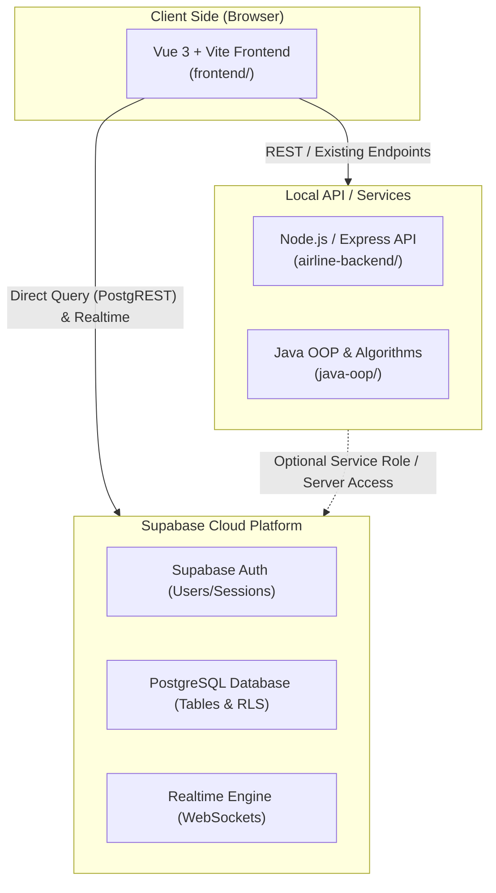

# Supabase Integration Guide: Architecture, Implementation & Step-by-Step Mapping

This document provides a comprehensive breakdown of the Supabase integration implemented for the **Airline Reservation & Management System**. It explains the role of every file, which step belongs to which part of your project, why each decision was made, and how to utilize Supabase across your application.

---

## 1. System Overview & Architecture Mapping

Your repository is a multi-tier engineering project composed of multiple subsystems:



### Why the Distinction Between `frontend/` and `airline-backend/` Matters

* **`frontend/` (Vue 3 + Vite)**: Uses ES Modules (`import / export`) and Vite's build tooling. Environment variables must be prefixed with `VITE_` and accessed via `import.meta.env.VITE_*`. This is where the public client lives because Supabase's client-side library is designed to allow browsers to communicate directly and securely with your database using **Row Level Security (RLS)**.
* **`airline-backend/` (Node.js + Express)**: Uses CommonJS (`require / module.exports`) and Node's runtime. Environment variables are loaded into `process.env`.
* **Root directory (`Airline/`)**: Contains workspace orchestration scripts and configuration. Files like `.gitignore` must govern the entire repository to keep credentials secure.

---

## 2. Where Each Step Is Applied in Your Project

| Step | Operation | Location / Target | Status | Purpose & Role |
| :--- | :--- | :--- | :--- | :--- |
| **Step 1** | Create Supabase Project | [Supabase Cloud Dashboard](https://supabase.com/dashboard) | ✅ Completed | Hosts your cloud PostgreSQL database, Auth, and Realtime engine. |
| **Step 2** | Retrieve Credentials | Supabase Dashboard (`Project Settings` → `API`) | ✅ Completed | Provides `Project URL` and `Publishable Key` (`anon key`). |
| **Step 3a** | Install Client Library | `frontend/package.json` | ✅ Installed | Installs `@supabase/supabase-js` so frontend Vue components can query Supabase. |
| **Step 3b** | Configure Environment | `frontend/.env.local` | ✅ Configured | Stores your project URL and publishable key locally on your machine. |
| **Step 3c** | Secure Secrets | Root `.gitignore` & `frontend/.gitignore` | ✅ Protected | Guarantees `.env*` and `*.local` files are never tracked or pushed to GitHub. |
| **Step 3d** | Initialize Supabase Client | `frontend/src/lib/supabaseClient.js` | ✅ Created | Reusable module exporting `supabase` singleton client for your Vue app. |
| **Step 3e** | Node Backend Integration | `airline-backend/src/lib/supabaseClient.js` | ✅ Created | CommonJS-compatible client if backend Express controllers need Supabase. |
| **Step 4** | Create Database Table & RLS | Supabase Dashboard (`SQL Editor`) | ✅ Verified | Creates `public.test_connection` with read permissions for the anon role. |
| **Step 5** | Test Connection | Terminal (`npm run test:supabase`) & Browser Console | ✅ Verified | Validates end-to-end connectivity and queries the database. |
| **Step 6** | Deployment Environment Config | Hosting Provider (Vercel, Netlify, Render) | 🚀 Ready | Set `VITE_SUPABASE_URL` and `VITE_SUPABASE_PUBLISHABLE_KEY` in deployment settings. |

---

## 3. Deep-Dive: File Changes & Code Explanation

### 1. `frontend/.env.local`
```env
VITE_SUPABASE_URL=https://mshlsvtvoqsncbxkfjua.supabase.co
VITE_SUPABASE_PUBLISHABLE_KEY=sb_publishable_o4J7GR_3BFm9JcOfy7tAWA__92ukAzu
```
* **Why `VITE_` prefix?** Vite ignores any environment variable that does not start with `VITE_` by default. This security feature prevents accidental leakage of system environment variables to the browser bundle.
* **Why `.env.local`?** In Vite, `.env.local` is loaded in all environments except `test` and takes precedence over standard `.env`. It is ignored by Git, ensuring personal credentials stay on your machine.

---

### 2. Root `.gitignore` (Repository Security)
```gitignore
# Environment variables & secrets
.env
.env.*
*.local
.env.local
```
* **Security guarantee**: This ensures that even if you run `git add .` or commit from VS Code, `.env.local`, `airline-backend/.env`, and any future secrets will **never** be uploaded to GitHub.

---

### 3. `frontend/src/lib/supabaseClient.js`
```javascript
import { createClient } from '@supabase/supabase-js'

const supabaseUrl = import.meta.env.VITE_SUPABASE_URL
const supabaseKey = import.meta.env.VITE_SUPABASE_PUBLISHABLE_KEY

// Create a single Supabase client for interacting with your database
export const supabase = createClient(supabaseUrl, supabaseKey)

// Helper function to test database connectivity
export async function testConnection() {
  const { data, error } = await supabase
    .from('test_connection')
    .select('*')

  if (error) {
    console.error('Supabase connection check:', error.message)
    return { success: false, error: error.message }
  }

  console.log('Supabase connection successful:', data)
  return { success: true, data }
}
```
* **`import.meta.env`**: Standard modern ESM syntax used by Vite to read environment variables at build/runtime.
* **`export const supabase`**: Allows any Vue view or component to import `supabase` and run queries (e.g., `supabase.from('flights').select('*')`).

---

### 4. `frontend/src/main.js` (Frontend Entry Point)
```javascript
import { createApp } from 'vue';
import { createPinia } from 'pinia';
import App from './App.vue';
import router from './router';
import './assets/main.css';
import { testConnection } from './lib/supabaseClient';

const app = createApp(App);

app.use(createPinia());
app.use(router);

app.mount('#app');

// Test Supabase connection on application startup
testConnection();
```
* **How it works**: When you launch your frontend with `npm run dev` and open `http://localhost:5173`, Vue mounts and immediately runs `testConnection()`. You can view the output in your browser Developer Console (`F12`).

---

### 5. `frontend/test-connection.mjs` (Instant Terminal Test)
```javascript
import { createClient } from '@supabase/supabase-js';

const supabaseUrl = process.env.VITE_SUPABASE_URL;
const supabaseKey = process.env.VITE_SUPABASE_PUBLISHABLE_KEY;

const supabase = createClient(supabaseUrl, supabaseKey);

async function test() {
  const { data, error } = await supabase.from('test_connection').select('*');
  if (error) {
    console.error('❌ Supabase error:', error.message);
    return;
  }
  console.log('✅ Supabase connected successfully!');
  console.log('Data returned from `test_connection`:', data);
}

test();
```
* **Associated npm script**: Added `"test:supabase": "node --env-file=.env.local test-connection.mjs"` to `frontend/package.json`.
* **Benefit**: You don't need to spin up the web browser just to check if your Supabase database is responding. You can run `npm run test:supabase` directly in your terminal.

---

### 6. `airline-backend/src/lib/supabaseClient.js`
```javascript
const { createClient } = require('@supabase/supabase-js');
const dotenv = require('dotenv');

dotenv.config();

const supabaseUrl = process.env.SUPABASE_URL || process.env.VITE_SUPABASE_URL;
const supabaseKey = process.env.SUPABASE_ANON_KEY || process.env.VITE_SUPABASE_PUBLISHABLE_KEY;

let supabase = null;
if (supabaseUrl && supabaseKey) {
  supabase = createClient(supabaseUrl, supabaseKey);
}

module.exports = { supabase };
```
* **Why this is needed**: The original guide was written for Vite frontend code (`import.meta.env`). If Node backend code imported that, Node would crash with `SyntaxError: Cannot use 'import.meta' outside a module`. We adapted this file to use standard Node `require()` and `process.env`.

---

## 4. Current Test Results

Running the terminal test script produced verified real-time results:

```bash
PS C:\Users\Admin\Desktop\Projects\Airline\frontend> npm run test:supabase

Connecting to Supabase at: https://mshlsvtvoqsncbxkfjua.supabase.co...
✅ Supabase connected successfully!
Data returned from `test_connection`: [ { id: 1, message: 'Supabase connected successfully!' } ]
```

The database query succeeded, Row Level Security allowed access, and the test record was fetched.

---

## 5. How to Use Supabase in Your Airline Project

Now that Supabase is connected, you can leverage it in your application:

### A. Querying Airline Data from Vue Components
In any Vue component (e.g. `FlightSearch.vue` or `PassengerDashboard.vue`), you can query Supabase directly:

```vue
<script setup>
import { ref, onMounted } from 'vue'
import { supabase } from '@/lib/supabaseClient'

const flights = ref([])
const loading = ref(true)

async function fetchFlights() {
  const { data, error } = await supabase
    .from('flights')
    .select('*')
    .eq('status', 'SCHEDULED')

  if (!error) {
    flights.value = data
  }
  loading.value = false
}

onMounted(() => {
  fetchFlights()
})
</script>
```

### B. Realtime Seat Availability (Live Seat Map)
When passengers book seats, you can update the seat layout live for all users without refreshing:

```javascript
import { supabase } from '@/lib/supabaseClient'

// Listen for updates on the seats table
const seatSubscription = supabase
  .channel('realtime-seats')
  .on(
    'postgres_changes',
    { event: 'UPDATE', schema: 'public', table: 'seats' },
    (payload) => {
      console.log('Seat updated in real time:', payload.new)
      // Update your Vue reactive seat map here
    }
  )
  .subscribe()
```

### C. Supabase User Authentication
You can replace or complement your custom JWT flow with Supabase Auth:

```javascript
import { supabase } from '@/lib/supabaseClient'

// Sign up a passenger
const { data, error } = await supabase.auth.signUp({
  email: 'passenger@example.com',
  password: 'SecurePassword123!'
})

// Sign in a passenger
const { data, error } = await supabase.auth.signInWithPassword({
  email: 'passenger@example.com',
  password: 'SecurePassword123!'
})
```

---

## 6. Checklist for Production Deployment (Step 6)

When deploying your frontend to **Vercel**, **Netlify**, or **Render**:
1. Do **not** upload `.env.local` to GitHub.
2. In your deployment dashboard (e.g., Vercel Project Settings → **Environment Variables**), add:
   * **Key**: `VITE_SUPABASE_URL` | **Value**: `https://mshlsvtvoqsncbxkfjua.supabase.co`
   * **Key**: `VITE_SUPABASE_PUBLISHABLE_KEY` | **Value**: `sb_publishable_o4J7GR_3BFm9JcOfy7tAWA__92ukAzu`
3. Trigger a redeploy. Vite will inject these environment variables into your production build automatically.

