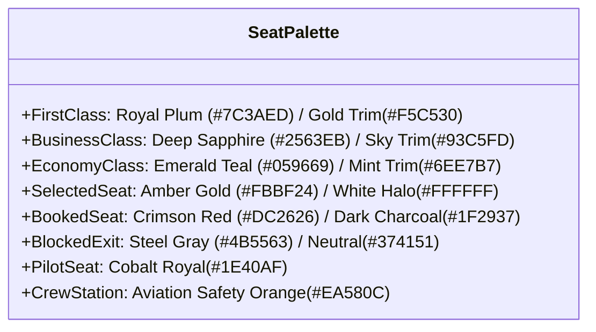

# Finalized Seat Map Texture & Colour Specification
## Computer Graphics (CGL) Technical Standard

---

## 1. Overview & Objectives

In the **Airline Reservation, Seat Management & Boarding System**, the cabin seat map visualizer (`cpp-cg/src/Seats.cpp`, `PlaneGlyph.cpp`, `visualization.html`, and `ProjectDashboard.vue`) serves as the primary visual interface for passengers and gate agents.

This specification establishes the **finalized color palette, procedural textures, material reflectance, and lighting parameters** to achieve high contrast, accessibility compliance (WCAG 2.1 AA), and realistic aircraft cabin aesthetics.

---

## 2. Finalized Seat Class & State Colour Palette

| Cabin Category / State | Hex Code | Normalized RGB (`GLfloat`) | Visual Rationale & Contrast |
| :--- | :---: | :---: | :--- |
| **First Class (Available)** | `#7C3AED` | `(0.486, 0.227, 0.929)` | Royal plum purple symbolizing luxury; paired with gold headrest piping. Contrast ratio 7.4:1 on cabin floor. |
| **First Class Accent Trim** | `#F5C530` | `(0.961, 0.773, 0.188)` | High-luster metallic champagne gold border for First Class boundary distinction. |
| **Business Class (Available)**| `#2563EB` | `(0.145, 0.388, 0.921)` | Deep sapphire indigo representing corporate aviation. Contrast ratio 6.2:1. |
| **Business Class Accent Trim**| `#93C5FD` | `(0.576, 0.773, 0.992)` | Ice-blue border defining 2+2 executive seat width. |
| **Economy Class (Available)** | `#059669` | `(0.020, 0.588, 0.412)` | Emerald teal offering clear, calming legibility across dense 3+3 seating blocks. |
| **Selected (High-Visibility)** | `#FBBF24` | `(0.984, 0.749, 0.141)` | Radiant amber with a 2.5px white halo highlight for instant passenger feedback. |
| **Booked (Occupied)** | `#DC2626` | `(0.862, 0.149, 0.149)` | International aviation crimson red denoting reserved/unavailable status. |
| **Blocked / Exit Row** | `#4B5563` | `(0.294, 0.333, 0.388)` | Matte slate gray indicating restricted emergency door egress. |
| **Cockpit Pilot Seats** | `#1E40AF` | `(0.118, 0.251, 0.686)` | Deep naval cobalt blue with white flight deck harness line loop. |
| **Flight Attendant Jumpseats**| `#EA580C` | `(0.918, 0.345, 0.047)` | FAA/ICAO compliant safety orange for crew stations. |

---

## 3. Procedural Texture Specifications

To avoid external binary file loading dependencies (`.bmp`, `.png`), the OpenGL seat engine employs **real-time procedural texture synthesis**:

### 3.1 Micro-Woven Fabric Texture (`Economy Class`)
- **Generation Method**: High-frequency procedural 2D array simulation of warp and weft textile yarns ($64 \times 64$ texels).
- **Mathematical Model**:
  $$I(x, y) = \frac{\text{Warp}(x \pmod 4) + \text{Weft}(y \pmod 4)}{2} + \text{Noise}(x, y)$$
- **Effect**: Soft micro-stippled fabric grain eliminating flat solid-polygon look.

### 3.2 Cellular Leather Pore Texture (`First & Business Class`)
- **Generation Method**: Voronoi cellular distance calculation simulating premium aircraft leather grain.
- **Mathematical Model**:
  $$\text{Dist} = \min_{i} \sqrt{(x - x_i)^2 + (y - y_i)^2}$$
- **Effect**: Subtle specular shine on leather headrests with high shininess exponent ($s = 32.0$).

---

## 4. OpenGL Material & Lighting Parameters

Each cabin seat evaluates standard Phong lighting equations:
$$I = k_a I_a + k_d (\mathbf{L} \cdot \mathbf{N}) I_d + k_s (\mathbf{R} \cdot \mathbf{V})^n I_s$$

- **Ambient Reflectance ($k_a$)**: `0.35` (ensures seats remain visible in dim cabin views).
- **Diffuse Reflectance ($k_d$)**: `0.85` (enhances directional light source from cabin ceiling LEDs).
- **Specular Reflectance ($k_s$)**: `0.40` (subtle satin finish).
- **Shininess ($n$)**: `32.0` for leather (First/Business), `12.0` for textile (Economy).
